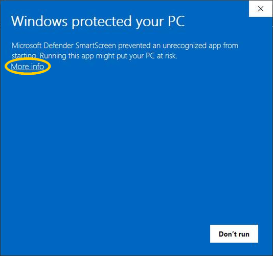
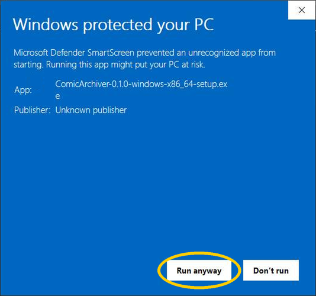

| Your computer | File |
|---|---|
| Windows 10 or 11 (64-bit) | [`ComicArchiver-{version}-windows-x86_64-setup.exe`](https://github.com/bcrute/comic-archiver/releases/download/v{version}/ComicArchiver-{version}-windows-x86_64-setup.exe) |
| Windows, without installing | [`ComicArchiver-{version}-windows-x86_64.zip`](https://github.com/bcrute/comic-archiver/releases/download/v{version}/ComicArchiver-{version}-windows-x86_64.zip) |
| Linux (x86_64) | [`ComicArchiver-{version}-linux-x86_64.tar.gz`](https://github.com/bcrute/comic-archiver/releases/download/v{version}/ComicArchiver-{version}-linux-x86_64.tar.gz) |

## Changes in {version}

- **Choose which episode types to save.** Set each provider to save paid or unlocked episodes, free episodes,
  existing limited unlocks, or episodes whose access type is unknown. Paid series include their free companion
  episodes. Changing these choices keeps your saved files.
- **See what's saved.** The Library page groups recorded episodes by provider and series, with saved and pending
  indicators, file format, and access type. Settings shows saved and pending counts by episode type and lists
  download issues for each provider.
- **Find more episodes you can read.** Tapas checks purchase history for series it may have missed. Webtoon
  checks the account's unlocked list and can save app-only episodes when the signed-in reader returns the complete
  episode.
- **Use the main controls on the dashboard.** Each provider card shows its status, time and space estimates, and
  transfer rate. Change speed or sign out from the card, and edit the shared library folder beside its path.
- **Save more novel chapters as EPUB.** The exporter handles older font markup and tables, and support logs
  give more specific reasons when chapter content cannot be saved.
- **Keep sign-in status current.** The app requests fresh account information when checking whether sign-in
  or sign-out has completed.

Each is self-contained: nothing else needs installing.

Windows install and update

The app is not signed yet, so Windows warns about it twice. Both warnings are expected.

1. If Edge says the file "isn't commonly downloaded", point at the download, choose **…**, then **Keep**. If it
   asks again, choose **Show more**, then **Keep anyway**.
2. Run the setup file. If Windows says "Windows protected your PC", its only button is **Don't run**. Don't
   press it. Click the small **More info** link under the message instead:

   

3. A **Run anyway** button then appears beside **Don't run**. Click **Run anyway**:

   

   It installs Comic Archiver for your own account and never asks for an administrator.

If Windows says Smart App Control blocked it and there is no **Run anyway**, Comic Archiver can't be installed on
that PC yet.

The installer's window and the app's first start can each take up to a minute while Windows checks the files;
later starts are quick.

**The first time**

1. On the dashboard, each site has its own card. Choose **Sign in** on your site's card, and sign in on the site's
   own page in the window with your email and password.
   Google and Facebook sign-in buttons may not work in that window. If that is how you normally sign in, first add
   a password to your account on the comic site itself (Tapas, Tappytoon or Webtoon, not Google or Facebook): sign in to the
   comic site in your usual web browser the way you always do, open your account settings, and set a password
   there. Then sign in to Comic Archiver with your account's email and that password.
2. Press **Start** on that card. Signed in to more than one site? **Start all** starts every one.

**Where your files go.** Into the folder `Comic Archiver` in your user folder (on Windows
`C:\Users\<your name>\Comic Archiver`): Tapas in `Tapas\Library`, Tappytoon in `Tappytoon\Library`, Webtoon in `Webtoon\Library`, one folder per series.
Comics are saved as CBZ files and novels as EPUB files, which open in comic and e-book reader apps.

**Updating.** Run the new setup file over the old version; don't uninstall first. If Comic Archiver is open, setup
closes it first, and a download pauses until you press Continue; version 0.2.3 or older asks you to close it yourself. Your saved sign-in data, settings and episodes stay. A provider can still require a new sign-in when its session expires. Uninstalling signs Comic Archiver out of every site and
removes your Backblaze key from this computer; your saved episodes are kept.

Linux install and update

Unpack the file, open the folder and double-click `comic-archiver` (choose "Run" if asked). After the
first start it is in your applications menu. Files go to `Comic Archiver` in your home folder, as above. To
update, close Comic Archiver, unpack the new version and start it: it offers to delete the older copy, and you
keep your saved sign-in data and settings. A provider can still require a new sign-in when its session expires. To
uninstall, right-click Comic Archiver in the applications menu, choose **Uninstall**, then delete the folder.

`SHA256SUMS.txt` lists each file's SHA-256, to check a download against. These files were built and self-tested
from the tagged source. `release-evidence.json` records the validation results and download
hashes checked by the Release workflow before publication.
